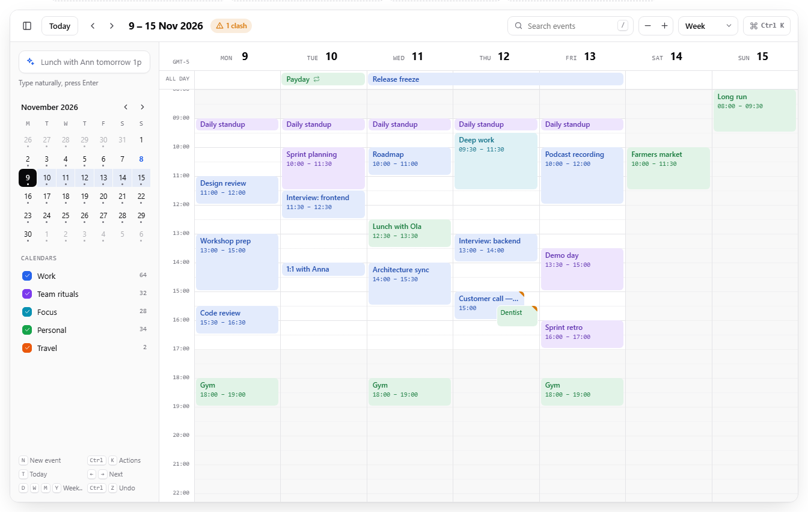
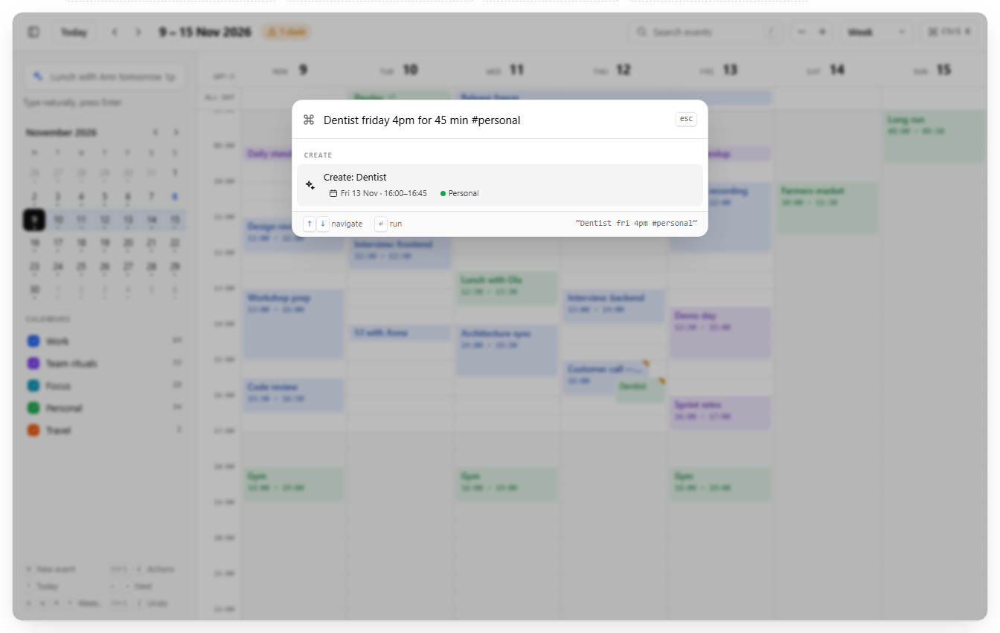
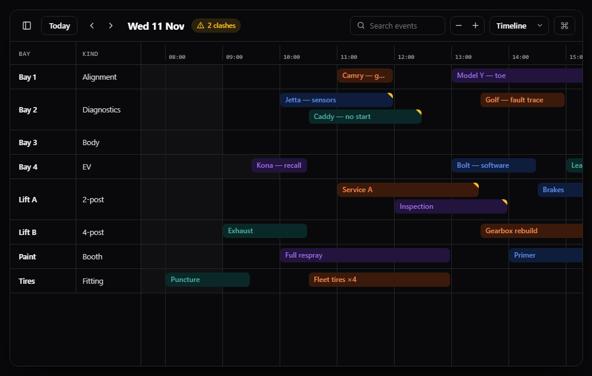
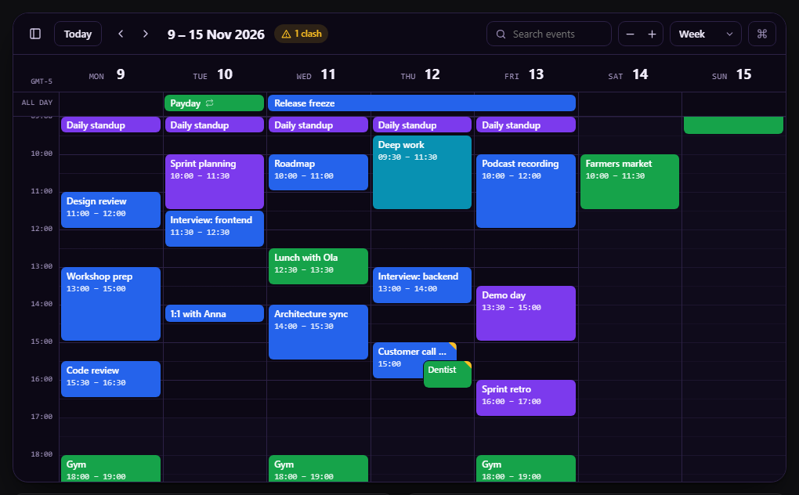
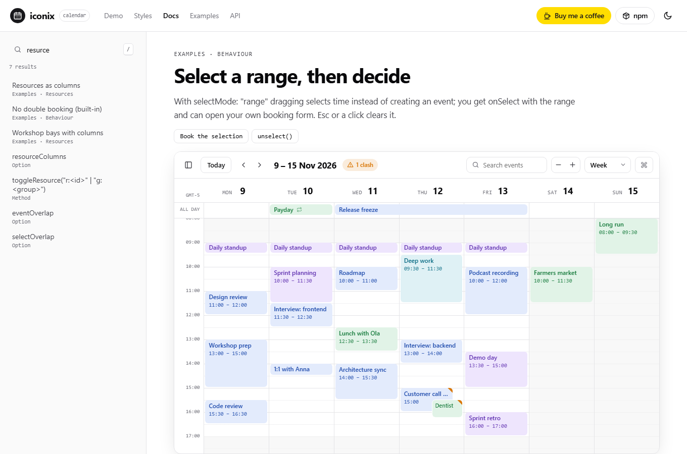
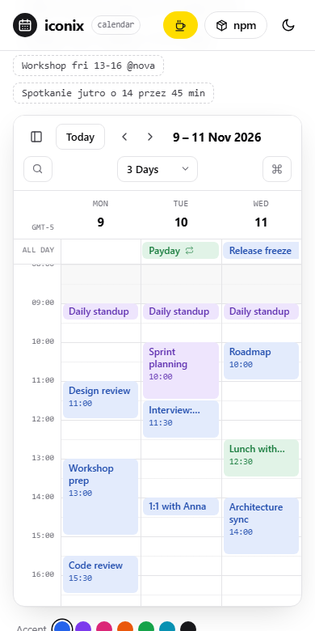

# @iconix/calendar

A keyboard-first event calendar for React, Vue and the web, from the makers of [@iconix/icons](https://bartek-figat.github.io/iconix-site/).

**[Live demo and docs →](https://bartek-figat.github.io/iconix-calendar/)** · [82 examples](https://bartek-figat.github.io/iconix-calendar/site/docs.html#ex-basic) · [npm](https://www.npmjs.com/package/@iconix/calendar)


[](https://bartek-figat.github.io/iconix-calendar/site/#demo)

- **13 views:** day, week, N days, resources as columns, month, week grid, multi-month, year heat map, agenda, list week / month / year and a resource timeline (day, week or month)
- **Event sources:** arrays, functions called per visible range, JSON feed URLs and `.ics` feeds, with lazy loading, a loading bar and `refetchEvents()`
- **Full repeat rules:** “2nd Tuesday”, “last Friday”, day 1 and 15, every N weeks, hourly, yearly in chosen months; all round-trip through `.ics`
- **Scheduling:** background events, business hours per resource, range selection (`selectMode: 'range'`), `eventOverlap` / `selectOverlap: false`, `validRange`, `eventAllow`
- **Drag & drop** from any list (`makeDraggable`) and between calendars (`droppable: true`)
- **Time zones** (`timeZone: 'America/New_York'`), **right-to-left** layouts, a **print** stylesheet and UI text in English, Polish, German, French and Spanish
- **Resources:** extra columns (`resourceColumns`), nested and collapsible resources, groups, events in several resources (`resourceIds`)
- **20 built-in tools:** natural-language quick add, ⌘K command palette, drag to create / move / resize, undo & redo, copy / paste / duplicate, free-slot finder, clash detection, recurring events, search, calendar filters, mini month, zoom, .ics import & export, themes, i18n, touch
- **Icons by [@iconix/icons](https://www.npmjs.com/package/@iconix/icons).** Every icon in the toolbar, editor, palette and events comes from the iconix set, imported from its tree-shakable `lite` entry. It is the only runtime dependency and installs automatically.
- **Search by [@iconix/search](https://www.npmjs.com/package/@iconix/search).** The toolbar search, the command palette and `searchEvents()` use its engine: typo tolerant (“desgn reveiw”), English and Polish word forms, field queries (`location:atlas`, `calendar:work`), relevance ranking and “Did you mean…”. Tune it with the `search` option. It installs automatically.
- Plain ES modules plus one stylesheet; React and Vue wrappers are optional.
- MIT licensed, resource timeline included.

```bash
npm i @iconix/calendar
```

## Screenshots

[](https://bartek-figat.github.io/iconix-calendar/site/#demo)

<table>
  <tr>
    <td width="50%"><b>Resource timeline with columns, dark</b><br></td>
    <td width="50%"><b>Grape preset, solid events, dark</b><br></td>
  </tr>
  <tr>
    <td width="62%"><b>Docs: 82 live examples with typo-tolerant search</b><br></td>
    <td width="38%"><b>On a phone</b><br></td>
  </tr>
</table>

Screenshots are generated from the site with `npm run screenshots`.

## React

```jsx
import { Calendar } from '@iconix/calendar/react';
import '@iconix/calendar/css';

<div style={{ height: 720 }}>
  <Calendar
    view="week"
    events={events}
    calendars={[{ id: 'work', name: 'Work', color: '#2563eb' }]}
    onChange={({ events }) => setEvents(events)}
  />
</div>
```

`ref` gives you the instance (`undo()`, `quickAdd()`, `gotoDate()`, `exportICS()`…). The entry carries `"use client"`, so Next.js Server Components can render it directly.

## Vue

```vue
<script setup>
import { IxCalendar } from '@iconix/calendar/vue';
import '@iconix/calendar/css';
</script>

<template>
  <IxCalendar :events="events" view="month" style="height: 720px" @change="({ events: l }) => (events = l)" />
</template>
```

In Nuxt, wrap it in `<ClientOnly>`.

## Web Component / plain JavaScript

```html
<link rel="stylesheet" href="https://cdn.jsdelivr.net/npm/@iconix/calendar/src/calendar.css">
<script type="module" src="https://cdn.jsdelivr.net/npm/@iconix/calendar/src/element.js/+esm"></script>
<ixc-calendar view="week" style="height: 700px"></ixc-calendar>
```

```js
import { createCalendar } from '@iconix/calendar';
const cal = createCalendar('#calendar', { events, onEventUpdate: ({ event }) => save(event) });
cal.quickAdd('Team lunch friday 12:30 #team');
```

## Events

```js
{ id, title, start, end, allDay, calendar, resourceId, color, location, notes,
  rrule: { freq: 'weekly', byweekday: [1, 3], interval, count, until }, exdates: ['2026-11-16'], editable }
```

`end` is exclusive (all-day events end on the following day, like iCalendar). Strings `'2026-11-12'` are all-day, `'2026-11-12T10:00'` is local time.

## Quick add

Understands English and Polish: `tomorrow 2pm-3:30pm`, `fri 16:30 for 45 min`, `12 dec`, `20.11`, `every weekday`, `co tydzień`, `all day`, `#calendar`, `@resource`.

## Keyboard

`⌘/Ctrl K` palette · `N` new · `T` today · `← →` navigate · `D W X M Y A R` views · `/` search · `⌘Z` / `⇧⌘Z` undo/redo · `⌘C ⌘V ⌘D` copy/paste/duplicate · `Del` delete · `F` free slot · `+ −` zoom · `B` sidebar · `Esc` close or cancel a drag.

## Event sources

```js
createCalendar('#calendar', {
  events: async ({ start, end, signal }) => (await fetch(`/api/events?from=${start.toISOString()}&to=${end.toISOString()}`, { signal })).json(),
  eventSources: [
    { id: 'team', ics: 'https://example.com/team.ics', color: '#db2777', editable: false },
    { id: 'api', url: '/api/bookings', startParam: 'from', endParam: 'to', transform: (r) => ({ id: r.uid, title: r.name, start: r.from, end: r.to }) },
  ],
  onLoading: ({ loading }) => (spinner.hidden = !loading),
});
```

## Hooks

```js
createCalendar('#calendar', {
  events,
  eventContent: (event, { variant }) => (variant === 'box' ? `<b>${event.title}</b>` : null), // render events yourself
  eventClass: (event) => (event.title.startsWith('Interview') ? 'is-hot' : ''),             // add classes
  eventDidMount: ({ el, event }) => { el.title = event.notes ?? ''; },                       // tooltips etc.
  eventAllow: (event, { action }) => event.start.getDay() % 6 !== 0,                         // refuse weekend drops
  dayClass: (date) => (isHoliday(date) ? 'holiday' : ''),                                    // style days
});
```

The docs site has 17 live examples (room booking without double booking, team planner, drag rules, holidays, recurring events, agenda widget, embedded month, branding, localization, event log, driving it from code, tooltips…).

## Styles

10 presets (`zinc`, `ocean`, `forest`, `sunset`, `grape`, `rose`, `nord`, `paper`, `mono`, `brutal`), each with light and dark tokens, and 8 event styles (`soft`, `solid`, `outline`, `stripe`, `pill`, `glass`, `gradient`, `minimal`):

```js
createCalendar('#calendar', { preset: 'nord', eventStyle: 'glass', theme: 'auto' });
// or your own preset
createCalendar('#calendar', { preset: { radius: 18, light: { accent: '#0f766e' }, dark: { accent: '#2dd4bf' } } });
```

## Theming

Every color, the radius and the fonts are CSS variables on `.ixc` (`--ixc-accent`, `--ixc-bg`, `--ixc-radius`, `--ixc-font`, …). Or use the `theme`, `accent`, `radius`, `density` and `eventStyle` options.

## CLI

The package installs an `iconix-calendar` command (Node 18+), handy in scripts and CI:

```bash
npx iconix-calendar parse "Dentist friday 4pm for 45 min #personal"   # sentence → event JSON
npx iconix-calendar convert export.ics -o events.json                 # .ics ↔ .json
npx iconix-calendar agenda events.json --days 7                       # upcoming events
npx iconix-calendar free events.json --duration 60 --hours 8-18       # next free slot
npx iconix-calendar clashes events.json --days 14                     # overlaps, exit 1 if any
npx iconix-calendar expand events.json --from 2026-11-01 --to 2026-12-01
npx iconix-calendar validate events.json                              # exit 1 on broken data
npx iconix-calendar stats events.json --days 30
npx iconix-calendar presets
npx iconix-calendar css nord --dark >> theme.css
npx iconix-calendar init react -o Schedule.jsx                        # react | next | vue | html | js
```

Add `--json` for machine-readable output. Exit codes: `0` ok, `1` the check found something (clash, invalid data, no free slot), `2` usage error.

## Development

```bash
npm run dev   # http://localhost:5178/site/ — the docs site with the live demo
npm test      # 59 unit tests: dates, recurrence, quick add, .ics, layout, model, presets, CLI and the Calendar UI (jsdom)
# site/review.html?c=paper:minimal,nord:pill:dark  — side-by-side style review page
```

## License

MIT
